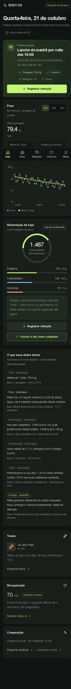
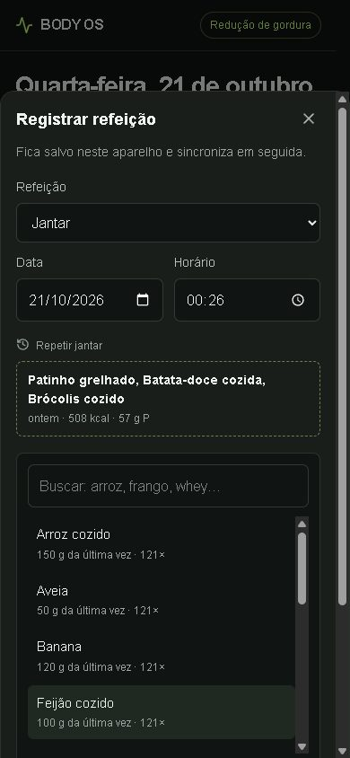
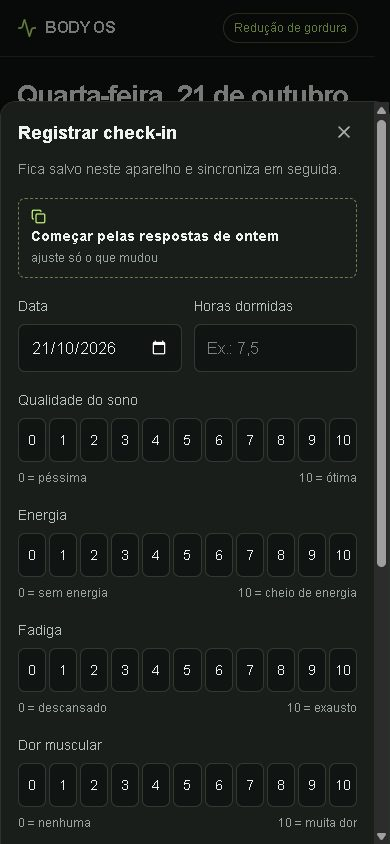
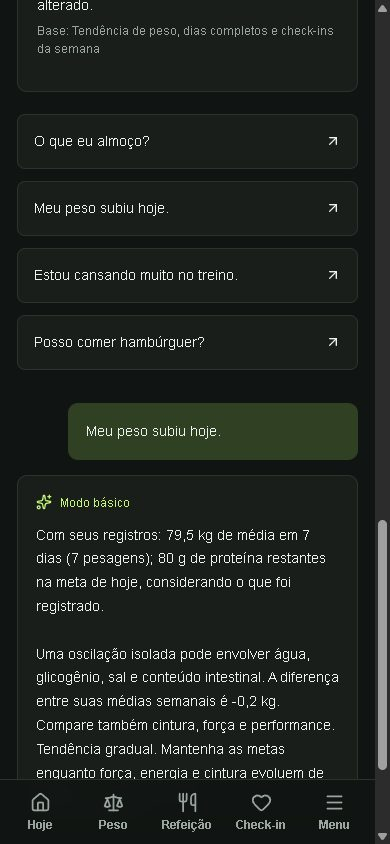
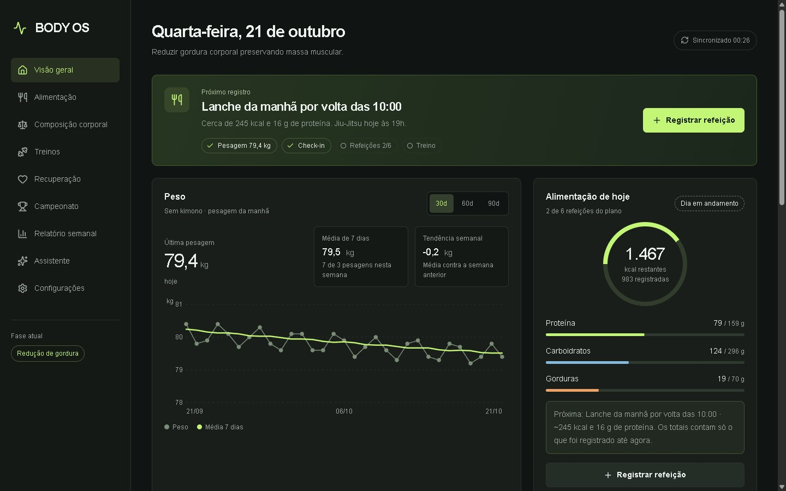

# BODY OS

Sistema pessoal para **composição corporal + performance + consistência**, com interface em português, dark/light mode e PWA mobile.

## Preview

Capturas de um **atleta de demonstração com dados sintéticos** (121 dias gerados para teste, nenhum dado pessoal), em celular emulado (390 px) e desktop, com o assistente em modo básico.

| Visão geral | Refeição | Check-in | Assistente |
|---|---|---|---|
|  |  |  |  |



A tela inicial diz o próximo registro do dia, quão antiga é a última pesagem, se já existe média de 7 dias (e quantas pesagens faltam) e o que os dados permitem concluir — cada leitura marcada como **observação**, **estimativa**, **sugestão** ou **dados insuficientes**, com a base usada. A refeição começa vazia, com a última combinação daquele horário para repetir em um toque. O check-in é feito por toques e nada vem pré-respondido.

## O que mudou em 2026-10

- **Integridade:** formulários não pré-preenchem valores que viram registro (antes a refeição abria com “Frango 150 g” e o check-in com 8 h/energia 7). Passos, FC, distância, minutos até cansar e notas ficam *não medidos* quando vazios, em vez de 0. Decimais aceitam vírgula (`85,4`).
- **Dia alimentar:** cada dia é *sem registro*, *em andamento*, *incompleto* ou *completo*. Só você fecha um dia; as médias de alimentação usam dias fechados quando existem.
- **Leitura honesta:** média de 7 dias só com 3 pesagens (tela inicial, gráfico e relatório seguem a mesma regra); idade da última pesagem visível; gráfico quebra a linha em intervalos de mais de 7 dias; referência informada aparece como ponto vazado.
- **Rotina mais rápida:** repetir refeição (do horário ou de qualquer dia), porção da última vez para cada alimento, repetir a estrutura do último treino, histórico do exercício com última carga, check-in a partir das respostas de ontem (escolha explícita), navegação por dia na alimentação.
- **Perfil e objetivos editáveis** em Configurações (antes só existiam como dados iniciais).
- **Semana em andamento** no relatório, calculada com as mesmas regras do relatório de domingo.
- **Backup completo** (inclui todo o chat) e **restauração com prévia**: novos, diferentes, iguais e inválidos por tipo; nada é apagado e registros existentes só são substituídos se você marcar.
- **Offline corrigido:** o service worker não guardava os arquivos do build (`/_next/static/`), então o app abria sem JavaScript sem rede. Agora abre offline; o selo no topo mostra *Sincronizado HH:MM*, *N pendentes* ou *Offline · N no aparelho*, e registros ainda não enviados aparecem como “no aparelho”.
- **Assistente:** contexto em texto compacto com período e quantidade de registros (antes: linhas JSON cruas que, com histórico longo, passavam da janela do modelo e eram truncadas), resposta em streaming, verificação de que o Ollama está ligado, e fallback para o modo básico **identificado** quando ele falha.
- **Desempenho:** gráfico SVG próprio no lugar do Recharts (chunk do app de 167 KB para 81 KB gzip), sincronização com ETag (sem mudanças, a resposta é 304 vazia) e um único GET após enviar a fila, fotos reduzidas no aparelho (1600 px, JPEG, sem EXIF) antes do upload.
- **iPhone:** `viewport-fit=cover` (áreas seguras de verdade), campos com 16 px no celular (sem zoom ao focar), diálogo sem foco automático no campo de data.

---

## Arquitetura entregue

- React 19, TypeScript, rotas App Router compatíveis com Next.js, executadas por **Vinext/Vite em Cloudflare Workers**. Não é uma instalação Next.js Node convencional.
- Tailwind CSS 4, componentes shadcn/ui (modal acessível com foco e Escape), Lucide e um gráfico SVG próprio (`app/chart.tsx`, com tabela acessível e leitura por toque/teclado).
- Backend HTTP autenticado, validação Zod e cálculos no servidor.
- Banco **D1/SQLite** persistente, com 23 tabelas separadas por domínio e índices por usuário/data. Fotos em **R2 privado**.
- Autenticação da plataforma na versão publicada. Cada consulta filtra o usuário autenticado; o site permanece restrito ao proprietário.
- A preferência por Supabase/PostgreSQL está documentada em `supabase/schema.sql`. Esse esquema é uma base de migração, **não um backend Supabase ativo**. Nenhuma credencial Supabase foi fornecida.
- IA generativa via Ollama no computador, validada localmente com llama3.2:3b. OpenAI é uma alternativa opcional. Sem um provedor configurado, o modo básico é identificado na interface e usa regras com os registros.

O núcleo está em `lib/body.ts`, as decisões e leituras em `lib/decisions.ts` (`insights()`), o contexto da IA em `lib/coach.ts` (`aiContext()`), a persistência em `lib/server.ts`, a fila offline em `lib/offline.ts`, os formulários em `app/forms.tsx` (campos em `app/fields.tsx`) e as telas em `app/views.tsx`.

A tabela `nutrition_days` (dias fechados como completos) é criada automaticamente com `CREATE TABLE IF NOT EXISTS` na primeira leitura; não há migração manual nem alteração em dados existentes. `drizzle/0001_nutrition_days.sql` documenta o mesmo comando.

## Rodar localmente

Requisitos: Node 22.13+ (testado com Node 24), npm e Git.

```sh
npm ci
npm run build
node --import ./scripts/sites-env.mjs ./node_modules/wrangler/bin/wrangler.js d1 execute DB --local --config dist/server/wrangler.json --persist-to .wrangler/state --file drizzle/0000_cheerful_mantis.sql
npm run dev
```

Abra o endereço impresso pelo servidor (normalmente `http://localhost:5173`). O atalho `scripts/abrir-body-os.ps1` sobe o servidor e abre uma janela do Edge; ele remove a trava `.vinext/dev/lock.json` quando a porta não responde (o vinext a deixa para trás quando o processo é encerrado à força, e um PID reaproveitado impedia o servidor de subir).

Para testar sem tocar nos registros reais de `.wrangler/state`, aponte o servidor para uma cópia: `BODYOS_STATE_DIR=<pasta> node node_modules/vinext/dist/cli.js dev --port 5180`. Aplique cada migração uma única vez no banco local. O desenvolvimento usa identidade `local-athlete` apenas em loopback, sob `import.meta.env.DEV`. Produção rejeita requisições sem identidade. Não exponha o servidor de desenvolvimento na internet.

Caso o npm do Windows esteja com resolução incorreta, execute seu `npm-cli.js` oficial com Node, por exemplo: `node "C:/Program Files/nodejs/node_modules/npm/bin/npm-cli.js" ci`.

## IA

O provedor escolhido é Ollama local; consulte a seção específica abaixo. Alternativamente, o código suporta `OPENAI_API_KEY` como segredo no servidor e `OPENAI_MODEL`. Não há chave OpenAI configurada. Credenciais nunca devem ir ao frontend, ao Git ou ao chat.

No desenvolvimento com Wrangler, use `.dev.vars` ignorado pelo Git, com as mesmas chaves do arquivo `.env.example`. O consumo da API é cobrado na conta fornecedora. Ollama foi validado com uma resposta real pelo endpoint do aplicativo local. A alternativa OpenAI não foi ativada nem testada com uma conta real. O site publicado permanece em modo básico até configurar a conexão HTTPS com o computador.

A IA recebe um resumo em texto montado por `aiContext()`: perfil, fase, metas, o dia de hoje, peso com idade da pesagem e base da média, alimentação dos 7 dias anteriores com o estado de cada dia, check-ins, treinos de 14 dias, medidas, evento e as leituras do app com sua base. Com 120 dias de histórico, o prompt caiu de 10.898 para 1.566 tokens (medido no llama3.2:3b); o formato antigo passava da janela de 8.192 e era truncado. Só entram como histórico as trocas dos últimos 30 minutos (no máximo 2), porque o modelo pequeno repetia respostas antigas. Fotos e seus bytes não são enviados; o histórico completo permanece no banco. `store:false` desativa o armazenamento opcional da resposta na API, sem prometer exclusão de todos os logs operacionais do provedor. Há limite básico de 100 conversas/dia por usuário e timeout de 45s. O limite não é um controle financeiro rígido de concorrência.

## Primeiros registros

Uma conta nova começa com o perfil vazio, sem pesagem e sem objetivos; a tela inicial pede cada passo.

1. Complete o perfil (idade, altura, sexo, intolerâncias, dias e horários de treino). Até lá, as metas usam valores genéricos (75 kg, 175 cm, 30 anos) apenas como ponto de partida.
2. Registre a primeira pesagem e as medidas de cintura, abdômen e pescoço.
3. Escolha a fase e cadastre seus objetivos em Configurações. O nome BODY OS também é editável ali.
4. Confira e edite valores dos alimentos pelo preparo ou rótulo; o catálogo inicial é aproximado.
5. Cadastre evento, data, categoria, pesagem e peso do kimono quando a organização confirmar.
6. Registre refeições, treinos e check-in. A tendência precisa de observações em duas semanas.

Não existem pesagens históricas, fotos, BF ou medidas inventados.

## Regras de cálculo

- Média de peso: observações dentro dos últimos 7 **dias de calendário**, sem preencher dias ausentes, exibida somente com **3 pesagens** na janela (tela inicial, gráfico e relatório). Um peso por dia nas gravações normais.
- Tendência: diferença entre médias de duas janelas consecutivas de 7 dias, exigindo pelo menos 3 observações por janela.
- Calorias iniciais: Mifflin–St Jeor, fator de atividade 1,55 estimado e ajuste conservador conforme fase. É ponto de partida, não gasto medido. Metas personalizadas prevalecem.
- Proteína inicial: 2 g/kg em redução/preparação e 1,8 g/kg em outras fases, editável. Referência solicitada de 1,8–2,2 g/kg em redução; adequação individual pode variar.
- BF por medidas: fórmula masculina US Navy, com abdômen/pescoço/altura convertidos de cm para polegadas. BF também pode ser informado por outro método. Não é medição exata.
- Massa magra e gordura: calculadas somente quando peso e BF têm a mesma data. Massa magra **não equivale a massa muscular**.
- Readiness: heurística limitada a 0–100, com sono, energia, fadiga, dor, estresse e carga recente. Não validada clinicamente.
- Plano do dia: as metas diárias são divididas em café da manhã (22%), lanche da manhã (10%), almoço (30%), lanche da tarde (10%), jantar (23%) e ceia (5%). Horários e percentuais são sugestões de rotina, não prescrição; o que conta é o total do dia. Uma refeição registrada com outro nome entra no horário mais próximo, então nada sai da soma do dia.
- Sugestão por refeição: o assistente de alimentação monta café da manhã, lanches, almoço, jantar ou ceia. Ele prioriza alimentos típicos da refeição escolhida entre os que você declarou ter, e dimensiona as porções pelo que ainda falta naquela refeição, com fator limitado entre 0,5x e 1,6x. Azeite e manteiga mantêm a porção pequena. Com poucos alimentos disponíveis, a sugestão pode ficar abaixo da meta da refeição; o valor restante continua visível.
- Dia alimentar: *completo* só quando você fecha o dia. Médias semanais e leituras usam os dias fechados quando existem; sem nenhum, usam os dias registrados e dizem que são parciais. O dia de hoje nunca entra nas médias.
- Não medido ≠ zero: passos, FC, distância, velocidade, inclinação, minutos até cansar, motivação e notas ficam ausentes quando não informados. Registros antigos com 0 nesses campos aparecem como “—”.
- Macros: nutrientes do alimento multiplicados pela razão quantidade/porção; calculados novamente no servidor. A refeição salva mantém um snapshot dos nutrientes, mesmo que o alimento seja alterado depois.
- Ajustes de energia: sugestões conservadoras, nunca alterações automáticas. Não usa calorias de relógio como verdade absoluta.
- Meta de peso (opcional, em Configurações): o app mostra quanto falta e o prazo num ritmo saudável de 0,5–1% do peso por semana, faixa usada pelo AIS para preservar força e desempenho. Com tendência disponível, compara o ritmo atual e sugere desacelerar se passar de 1% por semana. A meta nunca muda sozinha.
- Rotina: o perfil guarda dias e horário de musculação, Jiu-Jitsu e de um outro esporte (ex.: basquete). A tela inicial e o assistente usam o que está planejado para o dia; corrida e basquete são registrados em Cardio.
- Projeção de peso: extrapolação da tendência atual; incerteza aumenta com o prazo. BF/cintura futuros não são inferidos do peso.
- Risco de recuperação: alerta quando perda rápida, proteína registrada baixa, energia baixa, queda de força estimada e performance pior coexistem. Dados alimentares incompletos podem distorcer o sinal; não é diagnóstico.

## Relatórios e campeonato

O resumo de domingo é materializado **ao abrir o app no domingo ou depois**. Não existe tarefa de servidor em segundo plano nem notificação push configurada. Eventos com data passada são arquivados ao abrir o app; a fase permanece inalterada. O app apresenta uma revisão pós-evento. Datas não informadas não são adivinhadas.

As médias alimentares consideram dias com registro; o usuário pode ter registrado apenas parte desses dias. A pontuação de consistência do MVP considera pesagens, refeições e check-ins, não qualidade moral ou obediência a metas. A versão avançada pode incorporar proteína, treino e regularidade do sono.

## Fotos e PWA

Upload de JPG, PNG ou WebP até 8 MB, com validação de assinatura, armazenamento privado e consulta autenticada. Antes do envio, o aparelho reduz a foto para 1600 px em JPEG (normalmente menos de 1 MB) e descarta os metadados EXIF, como localização. HEIC precisa ser convertido no iPhone. As fotos são comparadas por posição, usando a foto mais recente e a anterior disponível pelo menos 30/60/90 dias antes. Não há análise visual automática.

No Safari do iPhone: Compartilhar → Adicionar à Tela de Início. HTTPS é necessário fora de localhost. Após uma primeira abertura conectada, o service worker mantém a interface e os arquivos estáticos. IndexedDB armazena uma cópia dos registros e uma fila de alterações por conta. Peso, refeições, treinos, medidas e check-ins podem ser salvos offline. O app sincroniza ao abrir, recuperar conexão, receber foco ou a cada minuto enquanto aberto. Não há promessa de sincronização com o app fechado no iPhone. Fotos, chat e exclusões continuam online. Use navegador atualizado com IndexedDB e Web Locks. Limpar os dados do navegador pode apagar alterações ainda não enviadas. Cópias locais não são criptografadas pelo aplicativo; use dispositivo pessoal protegido. A instalação em hardware iPhone não foi testada neste ambiente.

## Testar

```sh
npx tsc --noEmit
npm run lint
node --experimental-strip-types --test tests/*.test.ts tests/*.test.mjs
# Integração contra um servidor com banco de teste (nunca o real):
BODYOS_STATE_DIR=<cópia> node node_modules/vinext/dist/cli.js dev --port 5180
BODYOS_URL=http://localhost:5180 node tests/api.mjs
# Com o Ollama configurado no servidor de teste, acrescente BODYOS_EXPECT_AI=ollama
```

`tests/evolution.test.ts` cobre decimais com vírgula, não medido ≠ zero, horários, id diário compartilhado, estado do dia alimentar, médias com dias fechados, leituras com dados insuficientes, sugestão de categoria e o tamanho do contexto da IA. `tests/offline.test.ts` cobre também o caminho 304/ETag.

O teste de integração usa usuários de teste distintos no banco local e cobre seed, upsert diário, cálculos no servidor, validação, isolamento, proteção de origem, chat, foto privada e remoção de itens de refeição. Não aponta para produção. Dados de teste locais não fazem parte do pacote publicado.

## Limitações explícitas desta versão

- Supabase não conectado; base PostgreSQL fornecida para futura migração.
- Ollama funciona no app local; ativação no site publicado depende da conexão HTTPS autenticada com o PC. OpenAI não configurada.
- Sem leitura automática de rótulo/foto da comida ou BF por visão. Formulários manuais funcionais.
- Passos e frequência cardíaca são manuais; sem Apple Health/Garmin/WHOOP.
- Relatório e arquivamento acontecem ao abrir o app, sem cron em segundo plano.
- Sem push. Exportação e restauração JSON não incluem bytes de fotos.
- O modelo local llama3.2:3b comete erros de comparação e interpretação (por exemplo, dizer “abaixo” de uma referência com o peso acima dela). As respostas aparecem como “Ollama local”; um modelo local maior pode ser testado trocando `OLLAMA_MODEL`.
- Não há `.dev.vars` neste computador: o app local roda em modo básico até você criar o arquivo com `AI_PROVIDER=ollama`.
- PWA validado em Chromium com viewport de celular e rede simulada offline; não foi testado em um iPhone físico.
- Volumes de musculação são por exercício e data; ainda não há editor de programa ou progressão prescrita.
- Alimentação flexível e sugestões servem como organização, não acompanhamento profissional individualizado.

## Fontes

- ISSN, Protein and exercise: https://link.springer.com/article/10.1186/s12970-017-0177-8
- AIS, Making Weight in Weight Category Sports: https://www.ausport.gov.au/ais/position_statements/making-weight-in-weight-category-sports
- OpenAI Responses API: https://developers.openai.com/api/reference/cli/resources/responses/methods/create

As regras de segurança proíbem sugestões de diuréticos, laxantes, vômito, desidratação severa, restrição extrema de água, sauna agressiva, jejum prolongado para bater peso e medicamentos não prescritos.

## Sincronização e conflitos

Cada alteração recebe um identificador estável; reenvios não duplicam refeições ou itens. O servidor aplica uma comparação de versão antes da gravação e mantém itens dependentes na mesma transação. Uma edição concorrente mantém a alteração local pendente para revisão. O painel permite consultar o conteúdo local e descartá-lo em favor da versão do servidor. Nenhuma troca de conta envia registros da conta anterior. Falha de autenticação bloqueia a cópia local até novo login. A fila usa Web Locks para serializar abas do mesmo navegador. Um registro em conflito fica para revisão sem bloquear o envio dos demais. Depois de enviar a fila, o app faz uma única leitura do servidor (antes era uma por registro) e só então remove as operações; se essa leitura falhar, elas são reenviadas e o servidor responde "replayed" sem gravar de novo. A verificação a cada minuto manda o ETag da última cópia: sem mudanças, o servidor responde 304 sem corpo (com 120 dias de histórico, 0 byte em vez de ~500 KB) e a tela não é recalculada.

A atualização offline não exige migração de tabelas: o identificador da operação é mantido no JSON existente. O servidor continua sendo a fonte final dos registros sincronizados. Os testes simulam queda de conexão após envio, reenvio, conflito, mudança de conta e cache da interface sem cache de APIs ou telas de login.
## Ollama no computador

O assistente suporta Ollama pela API nativa `/api/chat`, mantendo o contexto do atleta e as instruções de segurança. Modelo inicial: `llama3.2:3b`, já instalado neste computador. Não exige chave OpenAI nem envia a inferência à OpenAI. O histórico e os registros continuam no servidor privado do BODY OS; isto não transforma o aplicativo inteiro em um sistema local.

Para desenvolvimento local, `.dev.vars` usa `AI_PROVIDER=ollama`, `OLLAMA_BASE_URL=http://127.0.0.1:11434` e `OLLAMA_MODEL=llama3.2:3b`. Esse arquivo é ignorado pelo Git. O serviço Ollama deve estar ligado.

Para o site publicado, localhost aponta para o servidor de hospedagem, não para o PC. O adaptador exige HTTPS e uma credencial privada para acessar o computador. `scripts/ollama-bridge.mjs` oferece somente chat em `127.0.0.1:11435`, autentica todas as chamadas, fixa o modelo, limita tamanho, concorrência e tokens, e não expõe os endpoints de instalação/remoção de modelos. A credencial fica em `work/ollama-bridge.env` no PC e como segredo `OLLAMA_BRIDGE_TOKEN` na hospedagem, nunca no navegador ou no código versionado.

O endereço estável pode ser fornecido pelo Tailscale Funnel, após autorização. Embora o endereço HTTPS seja alcançável pela internet, a ponte rejeita chamadas sem a credencial. O Ollama original permanece apenas no loopback. Não use `OLLAMA_ORIGINS=*` nem publique a porta 11434 diretamente. A inferência passa pelo transporte HTTPS do Tailscale e roda no PC.

Use `scripts/start-ollama-bridge.ps1` para iniciar a ponte configurada e `scripts/stop-ollama-bridge.ps1` para pará-la. O PC, o Ollama, o Tailscale e a ponte precisam ficar ligados. Se a ponte não responder, o chat mostra um erro explícito e preserva os registros. Não há troca silenciosa para OpenAI.

Testes: `node --experimental-strip-types --test tests/ollama.test.ts tests/ollama-bridge.test.mjs`.

Referências: https://docs.ollama.com/api/chat e https://tailscale.com/docs/reference/tailscale-cli/funnel.
